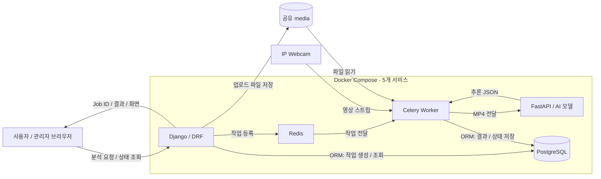
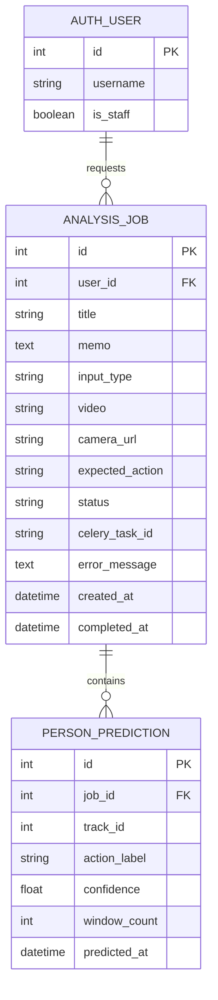
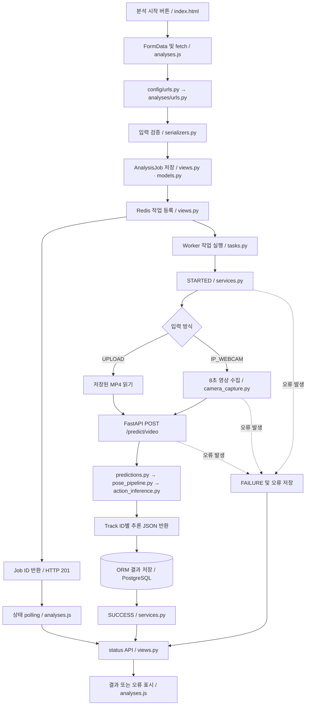
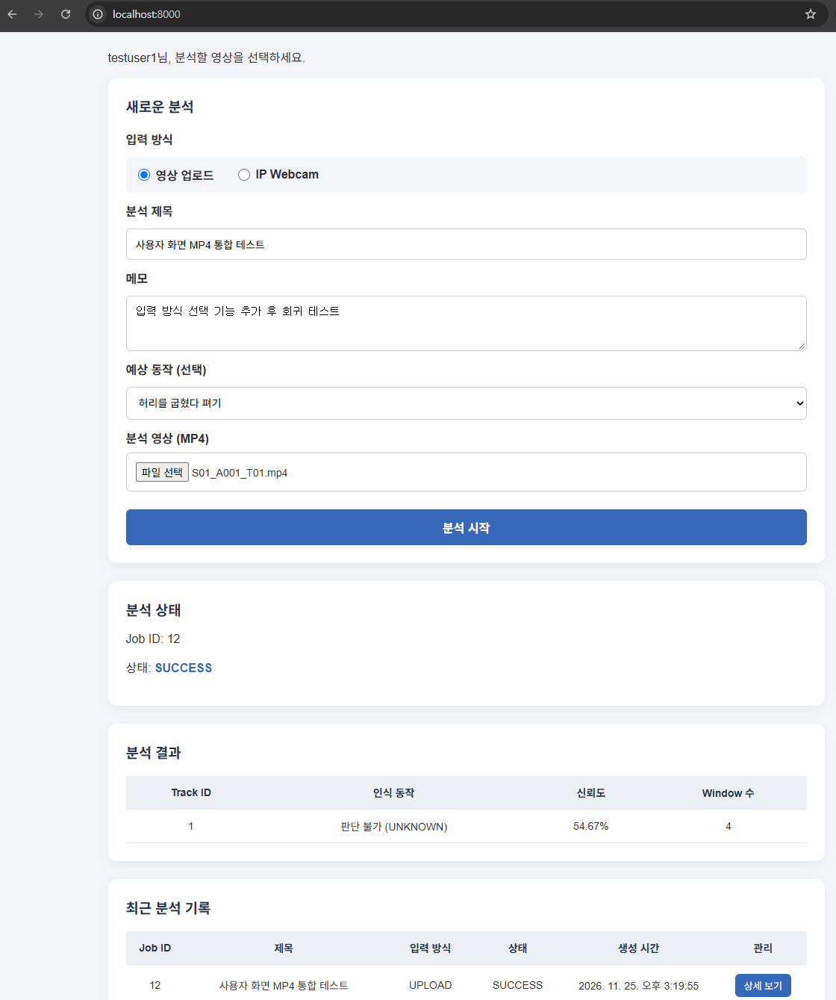
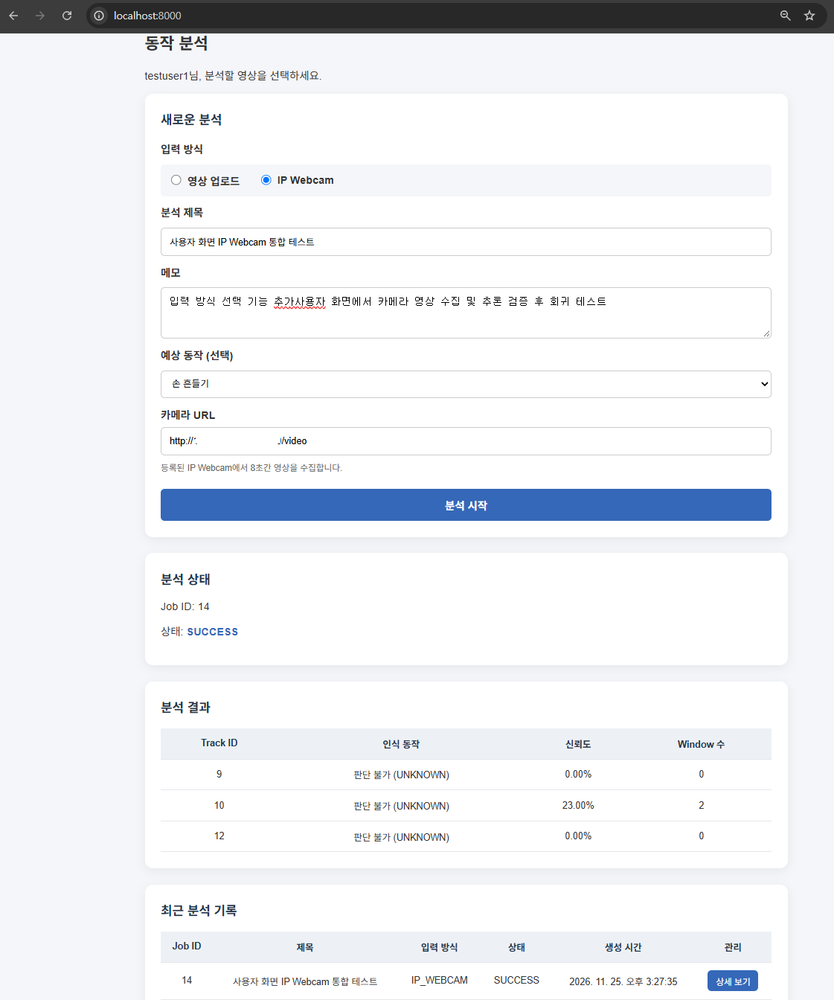
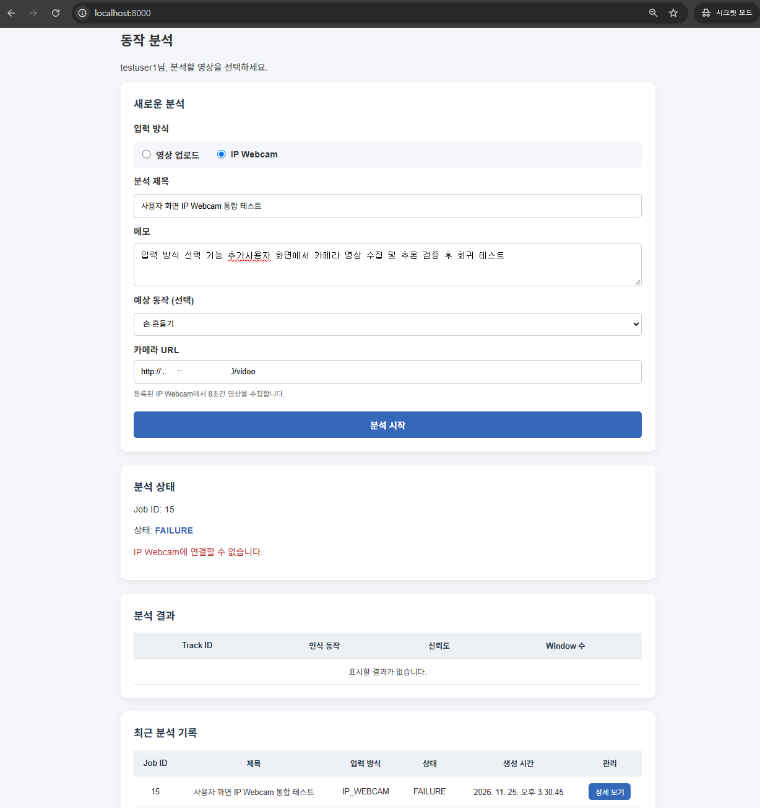
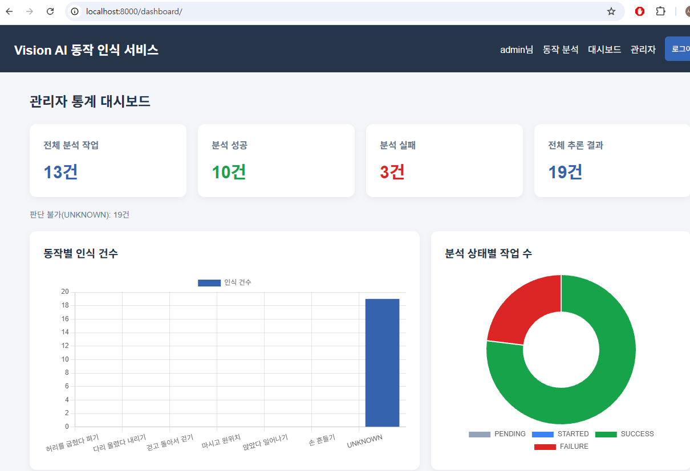
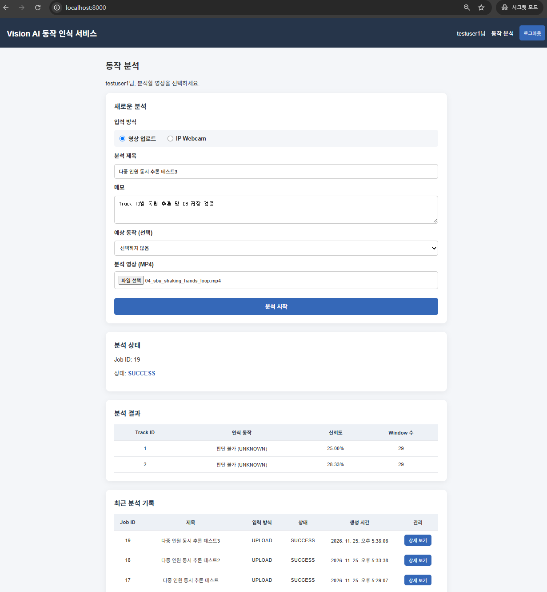
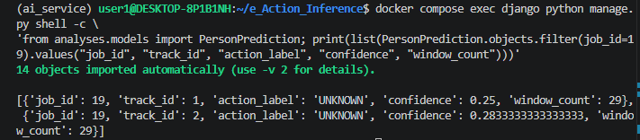

# Vision AI 동작 인식 서비스

`e_Action_Inference` | 개인 프로젝트 | 2026.11

## 1. 프로젝트 소개

기존 YOLO Pose 및 Random Forest 동작 인식 모델을 웹 서비스로 연결한 프로젝트입니다. 사용자는 로그인 후 MP4 영상 업로드 또는 IP Webcam 입력을 선택하여 분석을 요청하고, Track ID별 동작·신뢰도·분석 기록을 확인할 수 있습니다. 관리자는 전체 분석 작업과 추론 결과를 조회하고 통계 대시보드에서 집계 결과를 확인할 수 있습니다.

**기술 스택:** Python 3.12 · Django · Django REST Framework · FastAPI · PostgreSQL · Redis · Celery · Docker Compose · OpenCV · Ultralytics YOLO Pose · scikit-learn · JavaScript · Chart.js

## 2. 실행 방법

### 환경 설정

Docker Engine 및 Docker Compose가 설치된 환경에서 실행합니다.

```bash
git clone https://github.com/lee26060715/e_Action_Inference.git
cd e_Action_Inference
cp .env.example .env
```

`.env.example`을 기준으로 `.env`의 Django 비밀키, PostgreSQL 접속 정보 등 환경변수를 설정합니다. IP Webcam 사용 시 다음 항목도 설정합니다.

```dotenv
IP_WEBCAM_URL=http://YOUR_CAMERA_IP:8080/video
IP_WEBCAM_CAPTURE_SECONDS=8
```

카메라는 Worker 컨테이너에서 접근 가능해야 하며, 실제 접속 주소는 공개하지 않습니다.

### 모델 파일 준비

기존 6일차 모델 패키지에서 다음 파일을 `ai_service/models/`에 배치합니다.

```text
ai_service/models/
├── rf_action_baseline.joblib
├── rf_feature_columns.json
├── rf_training_info.json
└── yolo11n-pose.pt
```

모델 가중치(`.joblib`, `.pt`)는 Git 저장소에 포함하지 않으므로 별도로 준비해야 합니다.

### 컨테이너 실행

```bash
docker compose up -d --build
docker compose ps
docker compose exec django python manage.py migrate
docker compose exec django python manage.py createsuperuser
docker compose exec django python manage.py check
```

| 접속 화면 | 주소 |
|---|---|
| 사용자 화면 | http://localhost:8000/ |
| 회원가입 | http://localhost:8000/accounts/signup/ |
| 로그인 | http://localhost:8000/accounts/login/ |
| DRF API | http://localhost:8000/api/analyses/ |
| Django Admin | http://localhost:8000/admin/ |
| 관리자 대시보드 | http://localhost:8000/dashboard/ |
| FastAPI Swagger | http://localhost:8001/docs |
| AI 서버 상태 | http://localhost:8001/health |

```bash
# Worker 로그 확인
docker compose logs -f celery
# 종료 (PostgreSQL 볼륨 유지)
docker compose down
```

`docker compose down -v`는 영구 데이터 볼륨을 삭제할 수 있으므로 데이터 유지가 필요한 경우 사용하지 않습니다.

## 3. 전체 아키텍처



| 서비스 | 역할 |
|---|---|
| Django / DRF | 인증, 입력 검증, CRUD, 사용자 화면, 관리자 통계 |
| Redis | 비동기 작업 브로커 및 Celery 결과 백엔드 |
| Celery Worker | 영상 확보, FastAPI 호출, ORM 결과 저장 |
| FastAPI | Pose 추출, 특징 처리, Random Forest 추론 |
| PostgreSQL | 사용자, 분석 작업, 사람별 예측 영구 저장 |

FastAPI는 사용자 인증이나 DB 저장을 담당하지 않습니다. 업로드 파일은 Django와 Worker가 공유하는 media 경로에 저장합니다.

### 주요 프로젝트 구조

```text
e_Action_Inference/
├── backend/
│   ├── config/                  # Django 설정, URL, Celery 설정
│   ├── accounts/                # 회원가입
│   ├── analyses/
│   │   ├── models.py            # 분석 작업 및 예측 모델
│   │   ├── serializers.py       # API 입력 검증 및 직렬화
│   │   ├── urls.py              # DRF 라우터
│   │   ├── views.py             # 분석 API 및 작업 등록
│   │   ├── page_views.py        # 사용자 화면 및 대시보드
│   │   ├── tasks.py             # Celery 작업
│   │   ├── services.py          # 추론 요청 및 결과 저장
│   │   ├── camera_capture.py    # IP Webcam 영상 수집
│   │   └── admin.py             # 관리자 목록, 검색, 필터
│   ├── templates/              # HTML 화면
│   ├── static/                 # CSS, JavaScript
│   └── Dockerfile
├── ai_service/
│   ├── main.py                 # FastAPI 진입점
│   ├── routers/predictions.py   # 영상 추론 API
│   ├── services/
│   │   ├── model_loader.py      # 모델 및 Feature 규격 확인
│   │   ├── pose_pipeline.py     # Pose 및 Track ID 추출
│   │   └── action_inference.py  # Window 구성 및 RF 추론
│   ├── src/                    # 기존 특징 처리 코드
│   ├── models/                 # 모델 및 부속 JSON
│   └── Dockerfile
├── docs/
│   └── screenshots/           # 주요 기능 검증 자료
├── compose.yaml               # Docker Compose 서비스 구성
├── .env.example               # 환경변수 설정 예시
├── .gitignore
└── README.md
```

## 4. DB 설계 (ERD)



- `auth_user`: Django 기본 사용자 모델.
- `AnalysisJob`: 분석 입력, 요청자, 진행 상태 및 오류 정보.
- `PersonPrediction`: 한 작업에서 Track ID별로 생성된 예측 결과.

직접 작성한 모델은 `backend/analyses/models.py`에 있습니다. 사용자와 작업, 작업과 예측은 각각 1:N 관계입니다. Track ID는 분석 작업 내 추적 식별자이며 영구적인 개인 식별자가 아닙니다.

### API 및 접근 권한

| Method | Endpoint | 기능 |
|---|---|---|
| POST | `/api/analyses/` | 분석 요청 생성 |
| GET | `/api/analyses/` | 본인 작업 목록 |
| GET | `/api/analyses/{id}/` | 작업 상세 조회 |
| PATCH | `/api/analyses/{id}/` | 제목·메모 수정 |
| DELETE | `/api/analyses/{id}/` | 작업 삭제 |
| GET | `/api/analyses/{id}/status/` | 진행 상태 및 예측 조회 |

일반 사용자는 자신의 작업만 조회·수정·삭제할 수 있습니다. AI 결과 및 작업 상태는 사용자 API에서 읽기 전용이며, 관리자 대시보드는 staff 계정만 접근할 수 있습니다.

## 5. AI 추론 버튼 구현 흐름



작업 등록 후 브라우저는 Job ID를 받아 상태 API를 주기적으로 조회합니다. 최초 HTTP 요청은 AI 추론이 끝날 때까지 기다리지 않습니다.

## 6. 사용한 모델과 입력 형식

### AI 추론 파이프라인

```text
MP4 → YOLO11n Pose (COCO 17 Keypoints) → ByteTrack
    → Track ID별 특징 추출 (34 좌표 + 4 관절 각도)
    → 30-Step Sequence → 30 × 38 = 1,140 Features
    → Random Forest → Track ID별 예측 결과
```

기존 학습 모델과 Feature 순서를 재사용하며 재학습하지 않았습니다. 관절 좌표 정규화 및 시퀀스 처리 코드를 재사용하여 학습 입력 규격을 유지합니다.

| 클래스 | 동작 |
|---|---|
| `bend_return` | 허리를 굽혔다 펴기 |
| `leg_raise_lower` | 다리 올렸다 내리기 |
| `walk_turn_walk` | 걷고 돌아서 걷기 |
| `drink_return` | 마시고 원위치 |
| `sit_stand` | 앉았다 일어나기 |
| `wave` | 손 흔들기 |

| 항목 | 설정 |
|---|---|
| 영상 업로드 | MP4 |
| IP Webcam | 허용된 URL에서 8초 수집 후 MP4 변환 |
| 추론 Window | 3초, 최소 충족 비율 0.8 |
| 예측 간격 | 0.25초 |
| 신뢰도 임계값 | 0.55 |

FastAPI의 `POST /predict/video`는 MP4 파일을 받아 `predictions`와 `processing_time`을 반환합니다. 아래는 다중 인원 테스트 결과의 예측 배열입니다.

```json
[
  {"track_id": 1, "action_label": "UNKNOWN", "confidence": 0.25, "window_count": 29},
  {"track_id": 2, "action_label": "UNKNOWN", "confidence": 0.2833333333333333, "window_count": 29}
]
```

`UNKNOWN`은 학습 클래스가 아니라 신뢰도 기준 미충족 또는 유효 Window 부족 시 반환되는 판단 보류 결과입니다. 예상 동작은 사용자 입력 정보이며 모델 예측을 강제하지 않습니다.

## 7. 실행 결과와 검증

### 주요 실행 화면

<!-- 캡처를 docs/screenshots/에 배치하고 아래 파일명을 실제 이름과 일치시키세요. -->

| MP4 정상 처리 | IP Webcam 정상 처리 |
|---|---|
|  |  |
| Job 12: SUCCESS, Track 1, Window 4 | Job 14: SUCCESS, Track별 결과 표시 |

**카메라 연결 실패 처리**



Job 15: FAILURE 및 사용자 친화적 오류 메시지 표시.

**관리자 대시보드**



전체 작업, 성공·실패 건수, 동작별 결과 및 상태별 차트를 표시합니다.

**다중 인원 분석 및 DB 저장**




Job 19: Track ID 1·2에 각각 29개 Window를 생성하고 두 예측 레코드를 PostgreSQL에 저장했습니다.

### 통합 테스트 (2026.11.25)

| ID | 검증 항목 | 결과 및 근거 |
|---|---|---|
| T01 | 모델 로딩 | 통과 — 6개 클래스, 1,140 Feature 확인 |
| T02 | MP4 업로드 | 통과 — Job 12 SUCCESS |
| T03 | IP Webcam | 통과 — Job 11, 14 SUCCESS |
| T04 | 사람별 결과 | 통과 — 반복 편집 SBU 영상, Job 19의 Track별 Window 및 DB 저장 |
| T05 | 비동기 처리 | 통과 — HTTP 201, PENDING, Job ID 반환 |
| T06 | 영구 저장 | 통과 — ORM 조회 및 재시작 후 데이터 확인 |
| T07 | CRUD 권한 | 통과 — testuser2의 타 사용자 작업 GET/PATCH/DELETE 및 상태 조회 404 |
| T08 | 관리자 | 통과 — 전체 통계, 차트, 일반 사용자 접근 차단 |
| T09 | 예외 처리 | 통과 — 카메라 URL 누락 400, 연결 실패 FAILURE |
| T10 | Docker 재시작 | 통과 — 작업 13건·예측 19건 유지, 재시작 후 Job 16 분석 성공 |

### 문제 해결 사례

| 문제 | 원인 및 해결 | 검증 |
|---|---|---|
| IP Webcam 연결 실패 | 카메라 루트 URL 대신 `/video` 스트림 주소 사용 | 프레임 수신 및 MP4 생성 확인 |
| 짧은 영상에서 Window 미생성 | 기존 5초 Window를 3초로 조정 (30-Step 및 Feature 규격 유지) | 짧은 MP4에서 유효 Window 생성 |
| 다중 인원 영상의 Window 0 | 약 2초 이하 SBU 영상을 FFmpeg로 5회 반복 편집 | 두 Track에 각각 29개 Window 생성 |
| 사용자 화면 라디오 버튼 겹침 | 입력 방식 영역의 CSS 레이아웃 수정 | 두 입력 방식 전환 및 화면 표시 확인 |

IP Webcam 수집과 추론 시간을 분리하여 Worker 로그에서 확인했습니다. Job 11에서는 수집 8.02초(477프레임), AI 추론 10.659초가 기록되었습니다.

### 한계 및 개선 방향

- 제한된 학습 데이터로 인해 새로운 환경에서 UNKNOWN이 빈번하게 발생했습니다. 분석 작업의 SUCCESS는 처리 완료를 의미하며 동작 분류 정확도를 보장하지 않습니다.
- 다중 인원 검증에는 반복 편집한 SBU 영상을 사용했습니다. 실제 연속 촬영 환경의 ID 유지 및 분류 정확도까지 입증한 것은 아닙니다.
- IP Webcam은 고정 시간 수집 방식이며 연속 실시간 스트리밍 추론 서비스가 아닙니다.
- 향후 다양한 사람·환경의 학습 데이터 확보, Pose 품질 및 추적 안정성 개선, 운영 환경 보안 강화가 필요합니다.

---

개발 목적: 기존 AI 모델을 재사용하여 웹 요청, 비동기 처리, AI 추론, DB 저장 및 결과 시각화를 하나의 서비스로 연결하고 각 단계의 실행 흐름을 검증하는 것.
